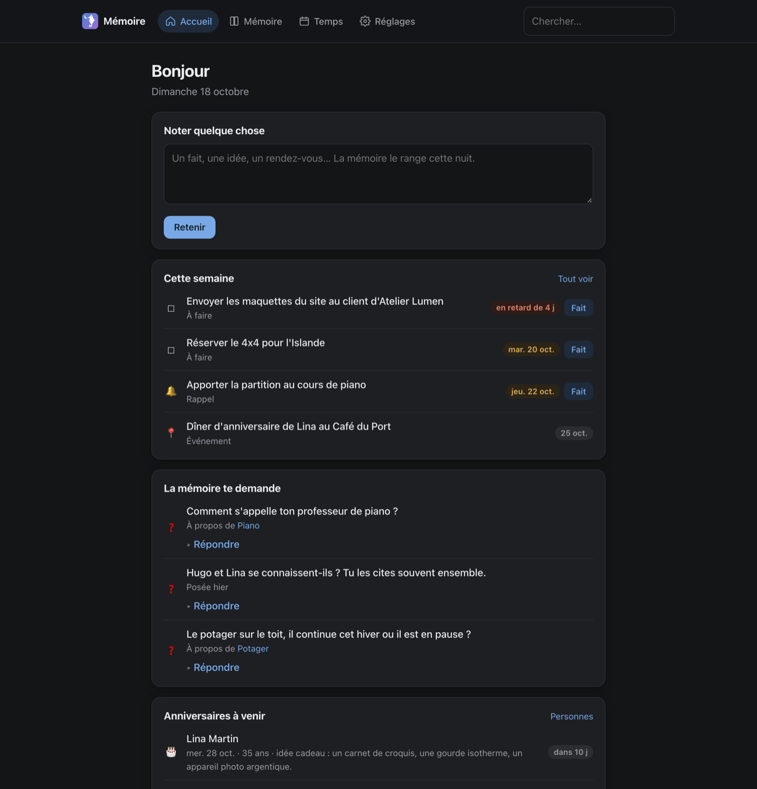
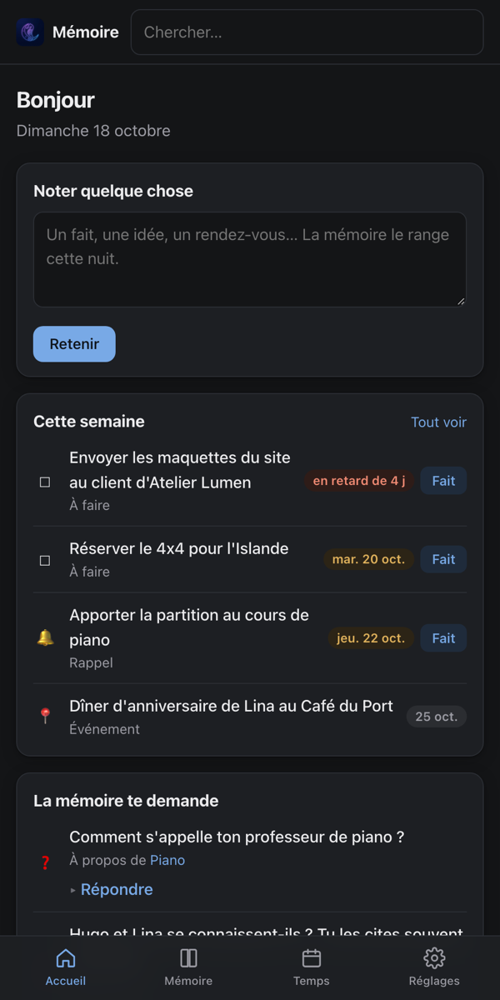
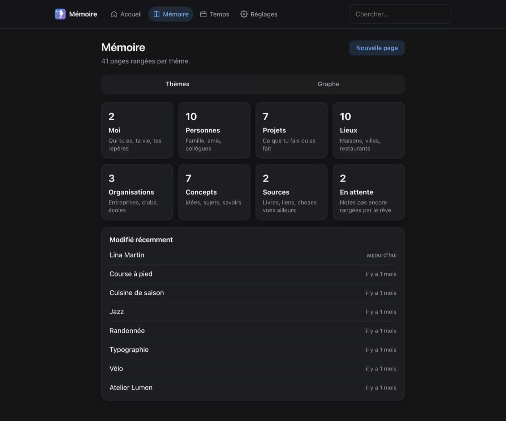
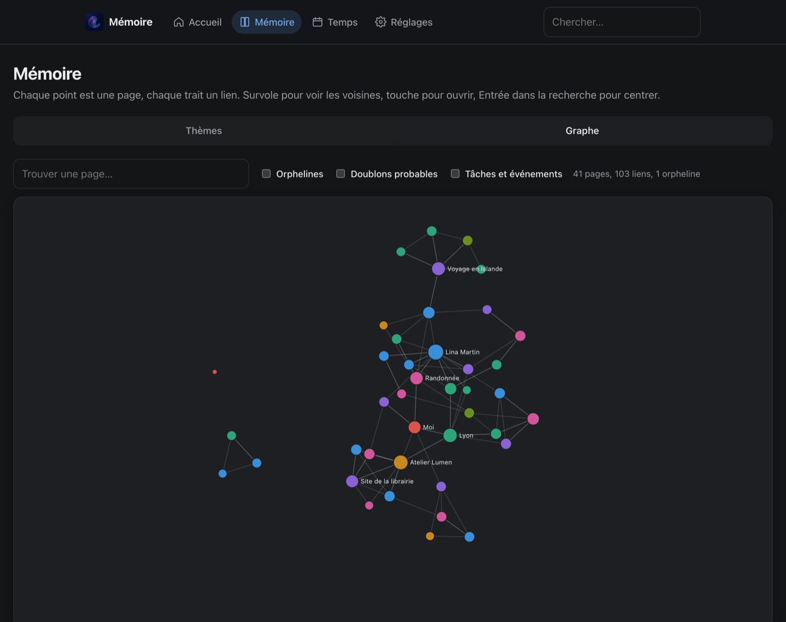
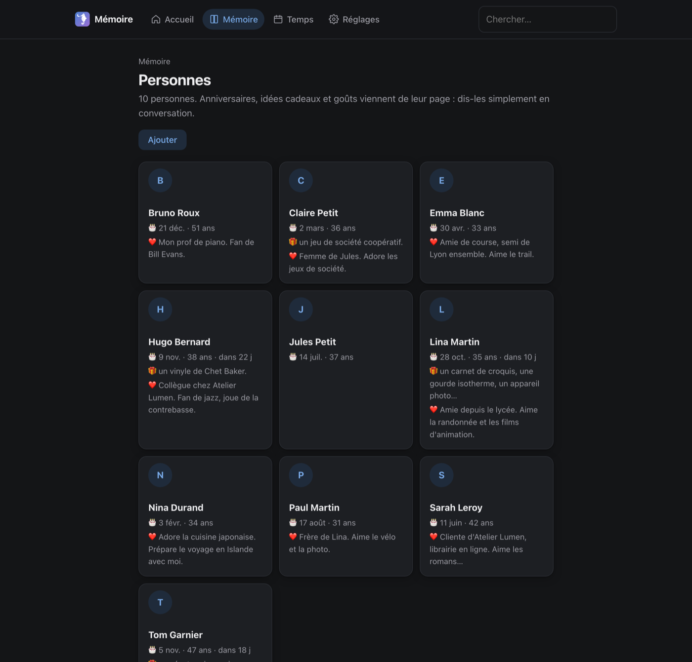
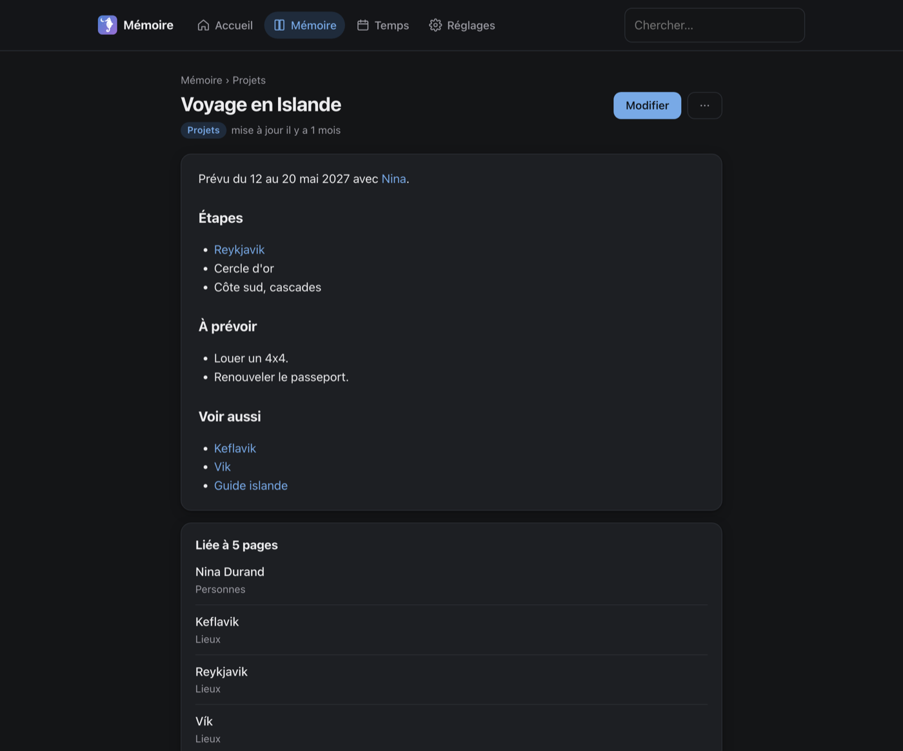
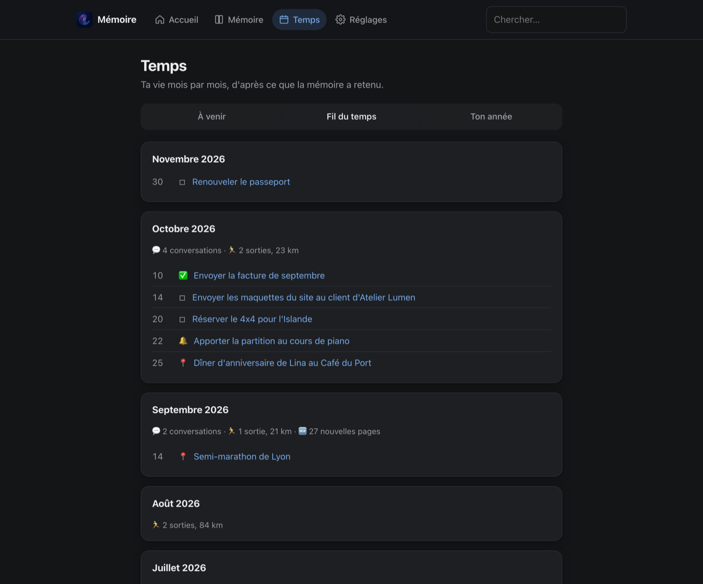
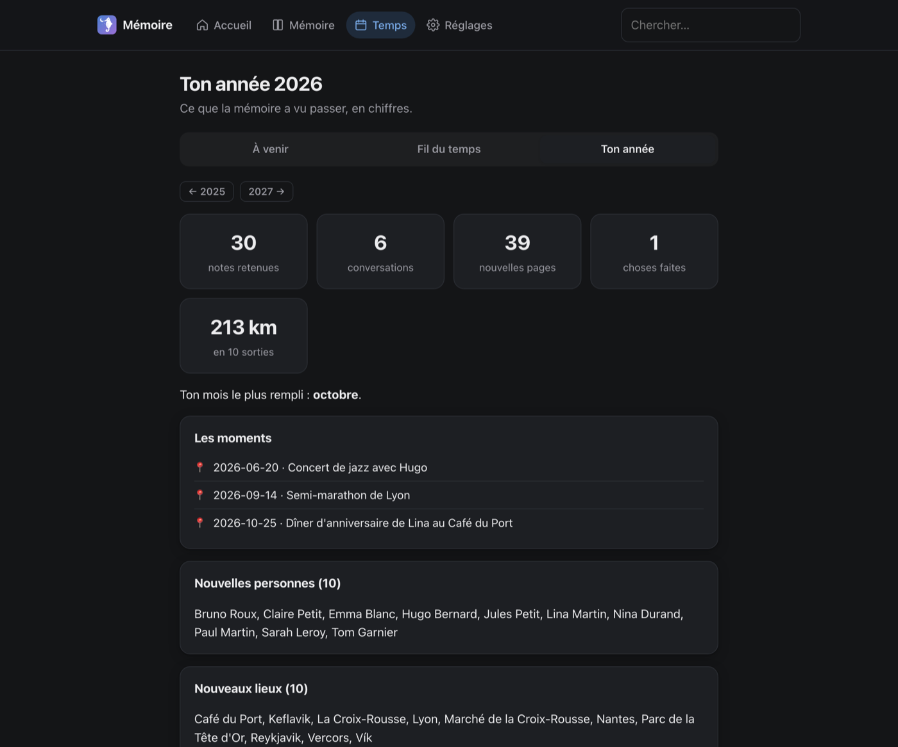
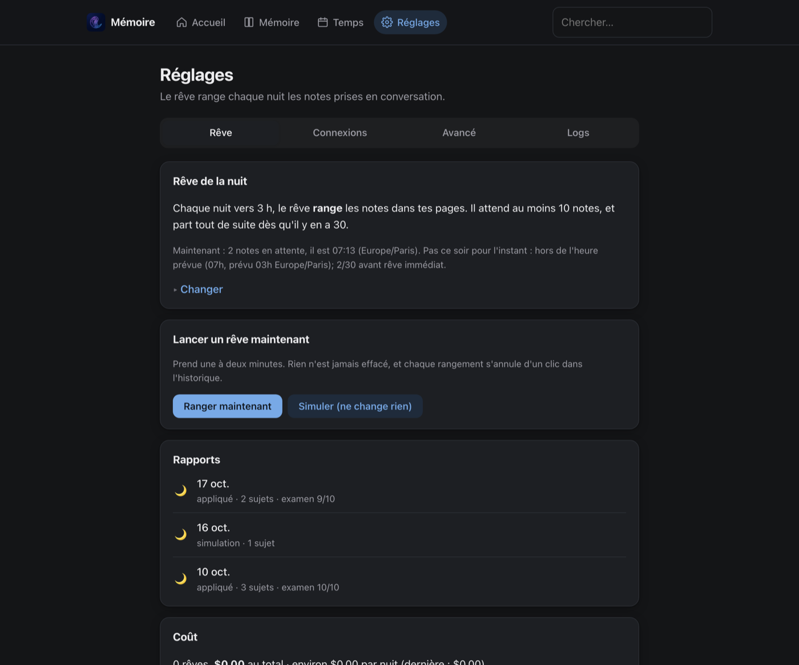

<p align="center"></p>

# Hippocampe

A persistent personal memory system for Claude, exposed as an
[MCP](https://modelcontextprotocol.io) server. It accumulates, organizes, and
surfaces a single user's knowledge over time. All data is plain **Markdown in a
git repo**: no database, no embeddings, no RAG. Git history is the audit log and
the undo button.

The name: the hippocampus is the part of the brain that sorts the day's
memories during sleep, which is what the nightly dream does here. In French,
*hippocampe* is also the seahorse in the logo.

The idea: while you talk to Claude, it captures notes into a fast "short-term"
layer. A nightly **dream** then distils those captures into curated long-term
pages, the same way memory consolidates during sleep. You can read and edit
everything through a private web console.

It is a standalone Python service: a Docker image, an HTTP MCP endpoint, and a
named volume holding the wiki. The code is path-agnostic via the `WIKI_ROOT`
environment variable, so it runs the same locally or on any host behind a
TLS-terminating reverse proxy.

## Screenshots

The web console (in French), filled with invented data.

| Home: notes, this week, questions from the memory | On a phone |
|---|---|
|  |  |

| Memory by theme | The graph of links between pages |
|---|---|
|  |  |

| People cards | A page with its backlinks |
|---|---|
|  |  |

| Timeline, month by month | Year in review |
|---|---|
|  |  |

| Dream settings and reports |
|---|
|  |

## Set it up for yourself

About half an hour, most of it waiting for DNS. The console is in French.

**You need:**

- a small server with Docker (any VPS will do) and ports 80 and 443 open;
- a domain or subdomain whose DNS record points at that server, e.g.
  `memoire.example.com`;
- a GitHub account (it is how you log in);
- a Claude plan that allows custom connectors;
- an Anthropic API key (console.anthropic.com). The nightly dream needs it to
  turn your notes into pages; without it, notes pile up and are never sorted.
  It is billed per use, separately from a Claude subscription, and the console
  shows what each night costs.

**1. Get the code on the server**

```sh
git clone https://github.com/FloLey/hippocampe.git
cd hippocampe
cp .env.example .env
```

**2. Create a GitHub OAuth app.** On GitHub: Settings -> Developer settings ->
OAuth Apps -> New OAuth App, with:

- Homepage URL: `https://memoire.example.com`
- Authorization callback URL: `https://memoire.example.com/`

Then generate a client secret. Keep the client ID and the secret for step 3.

**3. Fill in `.env`.** Each line is explained in the file: your domain, your
GitHub login (the only account let in), the OAuth app, a random signing key,
the vault key and the Anthropic key. Keep a copy of the vault
key somewhere safe: without it, the stored secrets cannot be read back.

**4. Start it**

```sh
docker compose up -d --build
curl https://memoire.example.com/health    # -> {"ok": true}
```

`compose.yaml` runs the wiki and Caddy, which gets the HTTPS certificate on its
own. The memory lives in the `wiki` Docker volume, so rebuilding or restarting
never loses it. To update later: `git pull && docker compose up -d --build`.

**5. Connect Claude.** In Claude.ai: Settings -> Connectors -> Add custom
connector, URL `https://memoire.example.com/mcp`, then Connect and log in with
GitHub. The connector then works in the Claude web, desktop and mobile apps.
For Claude Code:

```sh
claude mcp add --transport http memory https://memoire.example.com/mcp
```

**6. Ask Claude to use it every time.** In Claude.ai: Settings -> Profile ->
personal preferences, add something like:

> At the start of every conversation, call `prime` from my memory connector.
> When I tell you something worth keeping, save it with `remember`.

**7. Open the console** at `https://memoire.example.com/ui` (same GitHub login).
Start by writing your own page under Mémoire -> Moi. Réglages -> Connexions
adds the Telegram bot, Strava and Google if you want them.

## MCP tools (what Claude calls)

A deliberately small surface (a small surface is easier for the model to use
correctly):

- `prime()` - call FIRST: loads the grounding context (the `self/` pages, then
  the long-term and short-term indexes) in one call.
- `read(path)` - read any file: a page, an index, or a short-term entry.
  Tolerant of paths and suggests alternatives on a miss.
- `search(query_text, max_results?)` - keyword search (accent- and
  typo-tolerant, ranked by keyword rarity, a few lines per page), returning
  `path:line: text` matches. Dream reports and prompts are left out.
- `recall(topic)` - everything on one topic in one call: the best pages in
  full (long pages cut to the matching sections) with their backlinks, the
  active dated items, the recent unconsolidated notes, the open questions.
  prime stays short (long self sections and index descriptions are reduced,
  at most 150 pages listed, most linked and most recent first) and points
  here for detail.
- `remember(content, summary?, tags?, due?, type?)` - capture into short-term
  memory; `due`/`type` file dated items (todo, reminder, event) into `temporal/`.
  Anything that looks like a secret (key, password, document number) is moved
  to the encrypted vault before writing (masked when no vault is configured),
  so it never reaches the git history. Its reply lists the
  existing pages the note seems to be about and flags what it cannot settle
  (a first name several people pages share, "ma copine" without a name), so
  Claude asks the user right away instead of leaving the dream to guess.
- `complete(path)` - close a temporal item once it is done or cancelled, or an
  open question once answered (prime lists both with their paths).
- `secret(name)` - return one value from the encrypted vault, only when the
  user asks for it (prime lists the names, never the values).
- `GET /health` - liveness probe for the Docker healthcheck (public, not a tool).

Writing to **long-term** memory is intentionally **not** an MCP tool. It happens
through the web console or the nightly dream, never from a live conversation.
This keeps structural edits deliberate. All tools honour the owner allow-list
and a path guard, so `long_term/private/` is never read or searched.

## Questions instead of guesses

When the dream is unsure (two pages that may be the same person, conflicting
dates, done or only planned?), it does not guess: it files a short question in
`questions/`, keeps the uncertain part pending, and prime lists the open
questions so Claude asks them one at a time when the conversation allows. They
can also be answered from the console home page or the Telegram bot. A question
is keyed, so once answered it is never asked again. Likely duplicate pages found
by code, projects left untouched for months and missing birthdays of close
people are turned into questions the same way.

## Secrets vault

Things to remember that must never reach git (a recovery key, a document
number) live in one Fernet-encrypted file under `WIKI_VAULT_ROOT`, a separate
volume outside the wiki repo, sealed with `WIKI_VAULT_KEY`. Pages only hold a
reference such as `[SECRET: cle-wifi]`. The same vault keeps the connection
settings (OAuth tokens, the Telegram bot token). Generate a key with
`python -c "from cryptography.fernet import Fernet; print(Fernet.generate_key().decode())"`
and keep a copy outside the server: without it the vault cannot be opened.

## People cards

`/ui/memoire/people` shows each person: birthday (and age), gift ideas, what they
like, photo. Read from the pages as they are; the
write stage keeps a "## Fiche" section at the top of people pages. Birthdays
in the next 30 days are in prime, the next 14 days in the Sunday digest, and
the dream asks, one person per night, the birthday of the closest people
who have none on file.

## Photos

Any long-term page has an "Ajouter une photo" form in the console; a photo
sent to the Telegram bot with a caption goes to the page the caption is about.
Photos are re-encoded as JPEG (1600 px max), which drops EXIF and GPS, stored
under `media/<page>/` and linked from the page's "Photos" section. The graph
shows a page's first photo on hover.

## Timeline and year in review

`/ui/temps/fil` shows the life month by month: dated facts found in the pages,
events and closed todos, conversations, Strava totals and new pages.
`/ui/temps/annee?year=2026` is the year in review: notes, conversations, new pages
by category, the moments, sport, the most linked pages. Built on the fly,
without any model call.

## Exam

`exam/questions.md` (in the wiki, editable from the console) lists questions
with the words their answer must contain: `- Question ? → mot1, mot2`. After
each executed dream, every question is run through recall and checked, without
any model call; the score and the misses go in the report, the score in
`exam/history.md`, and a drop is flagged. The exam folder is left out of
search, so the answers never leak into what is checked.

## Connections (Strava, Google)

Set up from `/ui/reglages/connexions`, step by step on the page: create an API app with
the provider, paste its client id and secret (kept in the encrypted vault),
press Connecter. Each night at 02:00, before the dream, without any model call.
Note: Strava now asks for a paid subscription to create an API app, and limits
the use of its data with AI; check its current terms first.


- Strava: each activity is a row in `long_term/sources/strava-YYYY.md`, and
  each finished week becomes one short-term note the dream folds in.
- Google Calendar: the next 30 days become temporal events, kept in step
  (moved, renamed, cancelled or declined).
- Gmail: emails labelled `Mémoire` become short-term notes.
- The other way, in a "Mémoire" calendar of its own (the app can write only
  to calendars it created): birthdays as yearly events and dated todos and
  reminders, each with a short note (gift ideas, details, a link to the
  page), a reminder the day before, removed once done. Each kind has an
  on/off switch on the Google card.

## Conversation journal

Every tool call leaves a small trace (what was recalled, searched, saved,
closed) in an activity log on the vault volume, outside git. Calls less than
45 minutes apart form one conversation. Each finished day is compiled into
`journal/YYYY-MM.md`, one line per conversation, with no model call. prime
shows the last five conversations and what happened one year ago today;
recall adds the past conversations on its topic.

## Telegram bot

A private bot brings the memory to the phone, without a conversation. Set it up
from the console at `/ui/reglages/connexions`: paste the token from @BotFather (kept in
the encrypted vault, never in git), then tap the one-time link to bind your
chat. Messages from any other chat are ignored.

- Every Sunday at 09:00 (schedule timezone): the week's digest, overdue and
  upcoming items with a button that closes each todo, and the open questions.
- `/question` sends the next open question; the reply is remembered and the
  question closed. `/semaine` sends the digest now.
- Any other message is captured like `remember`, secrets moved to the vault. If
  the note is ambiguous (a first name two people share, "ma copine"), the bot
  asks one short question and remembers the answer.

The bot long-polls from a daemon thread (no webhook), and masks secrets in
everything it sends.

## How memory is organized

- **short-term** (`short_term/`): the open, fast-to-write layer. Every
  `remember` appends an entry here.
- **long-term** (`long_term/`): curated pages, including a `self/` section
  (identity, grounding) and a `private/` section never exposed over MCP.
- **temporal** (`temporal/`): dated, transient items (todo / reminder / event)
  that live until their due date, then are archived. A durable fact with no
  expiry belongs on a long-term page instead.
- **index**: each layer has a one-line-per-page index, regenerated by code so it
  cannot drift from the contents.

## The dream (nightly consolidation)

The dream reads short-term memory plus a policy file (`DREAM.md`, editable in the
console) and decides how to fold captures into long-term pages. It runs as a
**three-stage pipeline** so no single call ever needs the whole memory (cost
scales with the number of captures, not the wiki size):

1. **triage** - cluster and route each capture;
2. **decide** - per unit, reading only the touched pages, choose the action;
3. **write** - produce each page's final content and its index line.

Before deciding, each unit is shown, besides the pages triage routed it to, the
existing pages whose name or index description appears in its text (found by
code), and the active temporal items, so decide integrates into an existing
page rather than creating a duplicate, and closes (`temporal_done`) a todo that a
capture reports as done. The write stage receives the original captures, and a
rewrite that would shrink a page by more than 30% is refused. Stages use
structured JSON output when the model supports it. Every report ends with a
code-computed health section: prime size, likely duplicate pages, overdue items,
secrets in the self pages.

It has two modes, set from the console (`/ui/reglages/reve`):

- **dry-run** - stops after stage 2 and writes a report to `dream_reports/`,
  changing nothing.
- **execute** - runs stage 3 and applies everything in **one revertible git
  commit** (writes pages, files temporal items, drops consumed short-term
  entries, expires past-due items). It never deletes long-term content.

A built-in **scheduler thread** can run the dream once a night (`off` /
`dry-run` / `execute`, stored in `dream_schedule.json`). "Once a day" is enforced
by the presence of the day's report, so restarts never double-run and a missed
night is caught up. The model is `WIKI_DREAM_MODEL` (defaults to Opus 5.5,
overridable per stage via `_TRIAGE` / `_DECIDE` / `_WRITE`) and needs
`ANTHROPIC_API_KEY`. The three stage prompts are editable files
(`prompts/{triage,decide,write}.md`) viewable at `/ui/reglages/avance`; the JSON schema
is injected by code, so editing the guidance cannot break the contract.

## Web console (`/ui`)

A private, browser-facing console served by the same process, in French,
organised in four spaces (top bar on a computer, tab bar on a phone):

- **Accueil** (`/ui`): this week's todos with a "Fait" button, the memory's
  open questions to answer in place (`/ui/questions`), upcoming birthdays, last
  night's dream, recently changed pages, and a box to note something (saved like
  `remember`). Search lives at `/ui/recherche`.
- **Mémoire** (`/ui/memoire`): the pages by category (`/ui/memoire/people` as
  cards), the notes waiting for the dream (`/ui/memoire/attente`), the graph
  (`/ui/graphe`, data at `/ui/graph.json`), a page (`/ui/page/{path}`) with its
  backlinks, photo upload and actions, the editor (`/ui/modifier?path=`), a new
  page (`/ui/nouvelle`) and the raw file browser (`/ui/fichiers`).
- **Temps** (`/ui/temps`): what is coming, the month-by-month thread
  (`/ui/temps/fil`) and the year in review (`/ui/temps/annee`).
- **Réglages** (`/ui/reglages`): the dream (schedule, run now, reports, cost),
  connections, advanced (prompts, models, exam, secrets, tools) and server logs.

Every action is a POST with a signed CSRF token, then a redirect back with a
signed one-line confirmation. The old addresses (`/ui/graph`, `/ui/dream`,
`/ui/connections`...) redirect to the new ones.

Markdown is rendered with raw HTML disabled, so stored content cannot inject
markup.

## Authentication: GitHub OAuth + owner allow-list

The server uses FastMCP's `GitHubProvider` (an OAuth proxy running the OAuth 2.1
+ PKCE flow Claude.ai expects). On top of "any valid GitHub login", an allow-list
middleware restricts access to a single account (`WIKI_ALLOWED_GITHUB_LOGIN`), so
the wiki stays private to its owner. The browser console uses the same OAuth app.

### Configuration (environment variables)

| Variable | Required | Purpose |
|---|---|---|
| `GH_OAUTH_CLIENT_ID` / `GH_OAUTH_CLIENT_SECRET` | yes (prod) | GitHub OAuth; the server refuses to start without them unless auth is disabled |
| `WIKI_PUBLIC_URL` | prod | the public base URL of the server, e.g. `https://YOUR_DOMAIN` |
| `WIKI_ALLOWED_GITHUB_LOGIN` | yes (prod) | the single GitHub login allowed to use the wiki |
| `WIKI_JWT_SIGNING_KEY` | recommended | stable random value so tokens survive restarts |
| `ANTHROPIC_API_KEY` | yes | the nightly dream, which turns notes into pages |
| `WIKI_DREAM_MODEL` (+ `_TRIAGE`/`_DECIDE`/`_WRITE`) | no | dream model overrides |
| `WIKI_ROOT` | no | where the wiki lives (default `/srv/wiki`) |
| `WIKI_VAULT_KEY` | recommended | Fernet key of the secrets vault; without it secrets are only masked |
| `WIKI_VAULT_ROOT` | with the vault | where the vault and the bot/sync state live (a volume outside the wiki) |
| `WIKI_OWNER_NAME` | no | the owner's first name, used in the default dream prompts instead of "l'utilisateur" |
| `TELEGRAM_BOT_TOKEN` | no | the bot token, if not pasted in the console |
| `HOST` / `PORT` | no | listen address (default `0.0.0.0:8765`) |
| `WIKI_AUTH_DISABLED=1` | dev only | run open, no secrets needed |

Provide these through your deployment's environment (a `.env` file, container
secrets, an orchestrator, etc.). They are configuration, not committed to the
repo.

### GitHub OAuth app setup (one time)

Create a GitHub OAuth App (Settings -> Developer settings -> OAuth Apps) with:

- Homepage URL: `https://YOUR_DOMAIN`
- Authorization callback URL: `https://YOUR_DOMAIN/` (GitHub accepts any subpath,
  so both `/auth/callback` for Claude and `/ui/auth/callback` for the console
  work). Secret names must not start with `GITHUB_`, which GitHub reserves.

## Architecture

- **Transport:** Streamable HTTP, MCP mounted at `/mcp`, listening on `:8765`.
- **Data:** the wiki lives under `WIKI_ROOT` (default `/srv/wiki`), intended to
  be a persistent volume. The entrypoint seeds it from `seed/` only if empty,
  then `git init`s it, so restarts never clobber data.
- **Public URL:** `https://YOUR_DOMAIN/mcp`, behind a reverse proxy that
  terminates TLS (Caddy, nginx, Traefik, etc.).

```
hippocampe/
  Dockerfile
  compose.yaml            # wiki + Caddy, the one-command deployment
  deploy/Caddyfile
  .env.example            # every setting, explained
  docker-entrypoint.sh    # seed-if-empty + git init, then run the server
  pyproject.toml
  src/wiki_server/
    server.py             # FastMCP app: tools + /health
    store.py, query.py    # read / search / write over the markdown tree
    recall.py             # everything on one topic in one call
    capture.py            # remember: secrets out, ambiguities flagged
    paths.py              # path validation under WIKI_ROOT, refuses private/
    temporal.py           # dated items
    questions.py          # open questions instead of guesses
    vault.py, sensitive.py  # encrypted vault, secret detection
    dream/                # the staged consolidation pipeline + scheduler
    prompts.py            # editable dream prompts
    ui/                   # web console: layout + one module per space
    telegram.py           # the phone bot
    connections.py, sync.py  # Strava / Google OAuth and the nightly sync
    journal.py, timeline.py, people.py, media.py, exam.py, graph.py
  seed/                   # initial wiki content, copied into the volume once
  tests/
```

## Run locally

The fast way, with auth disabled (no OAuth needed; the dream needs an Anthropic
key, but the read/write tools do not):

```sh
docker build -t memory-wiki .
docker run --rm -p 8765:8765 \
  -e WIKI_AUTH_DISABLED=1 \
  -v "$PWD/.localwiki:/srv/wiki" \
  memory-wiki
```

Then:

```sh
curl -s localhost:8765/health        # -> {"ok": true}

npx @modelcontextprotocol/inspector
#   connect to: http://localhost:8765/mcp
#   call prime(), then read("self/identity.md")
```

The local volume is seeded from `seed/` on first run, so you get a working wiki
to poke at.

## Tests

The logic (store, temporal items, the dream pipeline, path guard, prime) is
covered by a fast pytest suite that runs against a throwaway wiki, with git
commits and model calls stubbed. No API key or network needed. Runs in CI on
every push.

```sh
pip install pytest        # or: pip install -e ".[dev]"
pytest -q
```

## Deployment

`compose.yaml` (see "Set it up for yourself") is the simplest path. The image
is a plain `Dockerfile`, so any Docker host works as long as the MCP endpoint
sits behind a reverse proxy that terminates HTTPS at your public URL, the env
vars above are supplied, and `WIKI_ROOT` is a persistent volume. A GitHub
Actions workflow (`.github/workflows/ci.yml`) runs the tests on every push and,
on `main`, builds and pushes the image to GHCR.

## Roadmap

Built so far: OAuth, the lean read/search/recall/remember tools, temporal
items, the secrets vault, open questions, the staged dream (dry-run, execute,
editable prompts, per-stage model, nightly schedule, exam), the web console,
the Telegram bot with its weekly digest, Strava and Google sync, the
conversation journal, timeline, people cards and photos.

Optional later: a "reorg" dream to fold residual duplicate pages.
